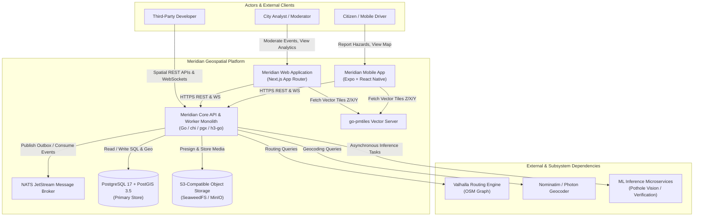
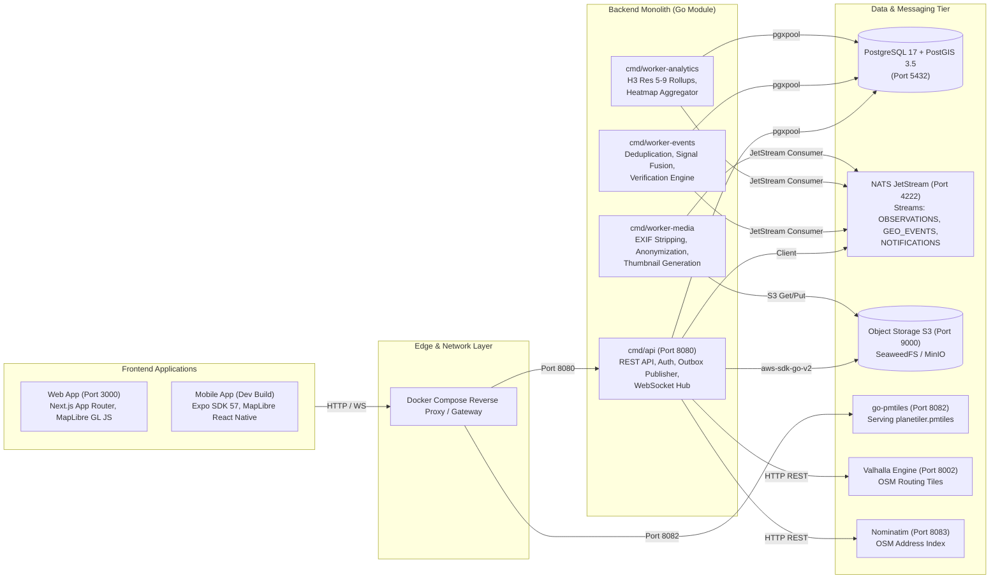
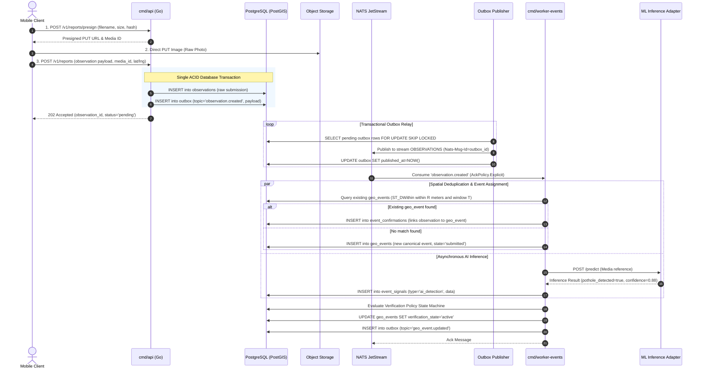
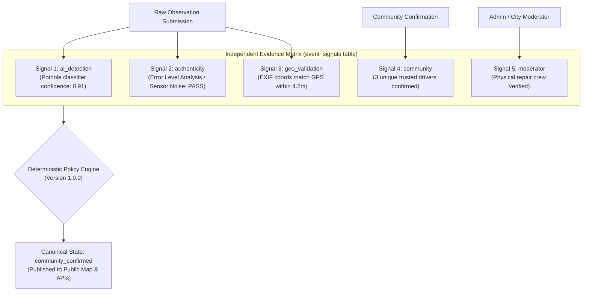

# Meridian Architecture: System Overview

**Document Version:** 1.0.0  
**Status:** Approved  
**Date:** 2026-11-22  
**Platform Codename:** Meridian  

---

## 1. Executive Summary & System Mission

Meridian is a self-hosted, cloud-independent Geospatial Intelligence Platform delivering high-performance spatial infrastructure, dynamic road-hazard intelligence, and verified geographic observations for a configured metropolitan region.

While consumer mapping applications focus exclusively on consumer point-to-point navigation, Meridian treats navigation as merely **one client application** of a broader geospatial engine. The platform provides:
1. **Interactive Vector Basemaps:** Autonomous, offline-capable PMTiles vector tile pipeline generated via Planetiler and served via `go-pmtiles` without reliance on third-party commercial tile services.
2. **Spatial Search & Geocoding:** Sub-millisecond geographic queries via PostgreSQL/PostGIS, accompanied by an isolated Nominatim/Photon geocoding adapter.
3. **Hierarchical Hexagonal Aggregation:** Multi-resolution spatial binning and heatmap statistics computed in Go using Uber H3 (`h3-go/v4`), stored as 64-bit integer indexes (`BIGINT`).
4. **Asynchronous Real-Time Event Fabric:** A transactional outbox event pipeline backed by NATS JetStream, routing deduplicated road events and spatial notifications to WebSocket consumers subscribing to localized H3 cells.
5. **Multi-Signal Hazard Intelligence:** AI-assisted pothole and road-surface damage detection, cryptographically authenticated media validation, community verification, and moderator oversight. Crucially, **signals are never averaged into a single opaque score**; each signal is preserved independently, with canonical verification states computed via deterministic, versioned state machines.

---

## 2. High-Level System Context (C4 Level 1)

The following diagram illustrates Meridian's boundaries, user personas, client interfaces, and external platform touchpoints:

---

## 3. Container Architecture (C4 Level 2)

Meridian is architected as a **modular monolith** with decoupled asynchronous worker daemons, avoiding microservice sprawl while maintaining clean internal boundaries:

---

## 4. End-to-End Observation Ingestion Pipeline

The report ingestion flow implements an asynchronous, resilient transactional outbox architecture:

---

## 5. Independent Signals Model

In consumer platforms, evidence from machine learning, image metadata, and user votes is often condensed into an opaque, single numerical trust score (e.g. `confidence: 72%`). Meridian explicitly rejects this model.

### 5.1. Core Principles
1. **Independent Provenance:** Every piece of evidence is persisted as an independent row in the `event_signals` table with its own creator, timestamp, schema-validated payload, and cryptographic signature where applicable.
2. **No Averaged Scores:** Signals are never blended into a single floating-point number.
3. **Decoupled Authenticity vs Truth:**
   - Image authenticity analysis verifies whether an image is an unmodified capture from a camera hardware sensor (as opposed to a downloaded meme, AI generation, or screenshot).
   - **Authenticity never proves location or capture time.** A genuine photo of a pothole taken in New York can be falsely submitted as an observation in Vadodara.
4. **Geo-Validation as an Independent Claim:**
   - Geo-validation algorithms compare device-reported GPS coordinates against EXIF GPS tags, cell-tower metadata, and road-network distance. This comparison generates a `geo_validation` signal, which is recorded as an independent claim.
5. **Deterministic Policy Derivation:**
   - The canonical `verification_state` (`unverified`, `community_confirmed`, `moderator_confirmed`, `disputed`, `rejected`) is derived deterministically by a versioned policy engine evaluated whenever new signals arrive.

---

## 6. Frontend Cartographic & UX Design Principles

Every web and mobile UI prompt across the Meridian platform must adhere to the following binding UX principles:

1. **Original Cartographic Identity:**
   - Meridian avoids generic copycat styling of Google Maps or Apple Maps. Basemaps utilize customized, restrained vector palettes prioritizing road network geometry, structural typography, and hazard clarity.
2. **Minimal, Premium Aesthetic:**
   - Monospaced coordinates, subtle elevation layering, muted neutral landcover, and high-contrast, purpose-driven semantic indicators for road hazards.
3. **First-Class Dark and Light Modes:**
   - Full tokenized color palettes for dark mode (optimized for night driving and control rooms) and light mode (optimized for daytime outdoor mobile visibility).
4. **Tokenized Design System:**
   - Spacing, typography, border radii, and elevation levels originate strictly from `packages/design-tokens` and `packages/ui`. Hardcoded pixel values and ad-hoc Tailwind colors are prohibited.
5. **Map Readability First:**
   - UI chrome, bottom sheets, and search panels float above the map canvas with translucent blurred backgrounds, ensuring the spatial context of the viewport is never fully obscured.
6. **Zero Silent States:**
   - Every data surface must provide explicitly designed states for:
     - `loading` (smooth skeleton shimmer, no erratic layout shifts)
     - `empty` (clear contextual explanation with a call to action)
     - `error` (RFC 9457 actionable error messages with retry buttons)
     - `permission-denied` (informative guidance for location or camera permissions)
7. **No Decorative Controls:**
   - Every visible button, toggle, and filter must connect to real, working application logic. No placeholder buttons or dead UI controls.
8. **Visible Attribution:**
   - OpenStreetMap ODbL and OpenMapTiles attribution must remain visible on every interactive map canvas in compliance with Section 4.3 of the ODbL license.
