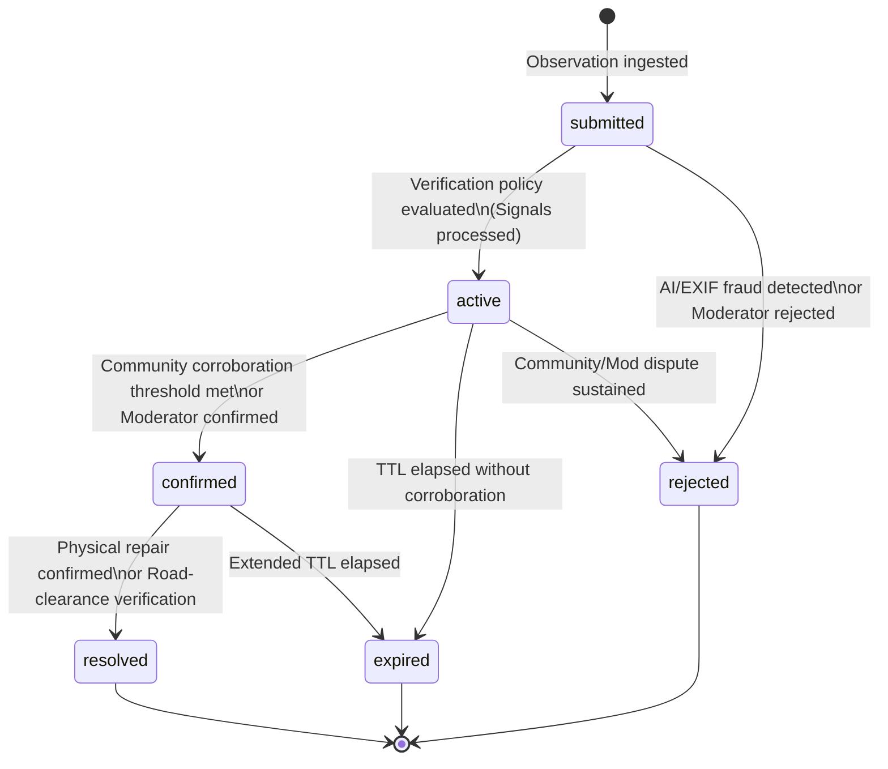

# Meridian Domain Model & Entity Specification

**Document Version:** 1.0.0  
**Status:** Approved  
**Date:** 2026-11-22  
**Platform Codename:** Meridian  

---

## 1. Overview & Data Invariants

The Meridian domain model provides high-performance spatial indexing, strict provenance tracking, and tamper-evident event lifecycles.

### Platform-Wide Invariants:
1. **Primary Keys:** Every entity utilizes a **UUIDv7** primary key (`id UUID PRIMARY KEY`), guaranteeing temporal locality in B-Tree indexes.
2. **Timestamps:** Every timestamp column is `timestamptz` stored and serialized in **UTC**.
3. **Spatial Reference:** All spatial geometries are stored as `geometry(Point, 4326)` with WGS 84 coordinate order `[longitude, latitude]`.
4. **H3 Spatial Index:** All point features store their canonical Resolution 9 H3 index as a 64-bit integer (`BIGINT`).
5. **Immutability of Raw Ingestion:** `observations` and `event_signals` are **append-only and immutable**. Once written, their attributes are never altered.
6. **No Phantom Soft Deletes:** Historical state changes are recorded in `event_history`. Deletions or cancellations transition the entity's status or record a tombstone.

---

## 2. Entity Catalog & Schema Specifications

### 2.1. Users & Authentication

#### `users`
Represents registered platform citizens, verifiers, and administrative moderators.
```sql
CREATE TABLE users (
    id UUID PRIMARY KEY, -- UUIDv7
    email VARCHAR(255) NOT NULL UNIQUE,
    password_hash VARCHAR(255) NOT NULL, -- Argon2id
    role VARCHAR(32) NOT NULL DEFAULT 'user', -- 'user', 'moderator', 'admin'
    trust_score DOUBLE PRECISION NOT NULL DEFAULT 1.0, -- Dynamic reputation [0.0 - 5.0]
    is_active BOOLEAN NOT NULL DEFAULT true,
    created_at TIMESTAMPTZ NOT NULL DEFAULT NOW(),
    updated_at TIMESTAMPTZ NOT NULL DEFAULT NOW()
);
CREATE INDEX idx_users_email ON users(email);
```

#### `sessions`
Tracks active user authentication sessions and refresh token rotation.
```sql
CREATE TABLE sessions (
    id UUID PRIMARY KEY, -- UUIDv7
    user_id UUID NOT NULL REFERENCES users(id) ON DELETE CASCADE,
    refresh_token_hash VARCHAR(64) NOT NULL UNIQUE, -- SHA-256 of opaque token
    user_agent TEXT,
    ip_address INET,
    expires_at TIMESTAMPTZ NOT NULL,
    revoked_at TIMESTAMPTZ,
    created_at TIMESTAMPTZ NOT NULL DEFAULT NOW()
);
CREATE INDEX idx_sessions_user ON sessions(user_id) WHERE revoked_at IS NULL;
```

#### `api_keys`
Hashed API keys for third-party developer integration.
```sql
CREATE TABLE api_keys (
    id UUID PRIMARY KEY, -- UUIDv7
    user_id UUID NOT NULL REFERENCES users(id) ON DELETE CASCADE,
    name VARCHAR(128) NOT NULL,
    key_hash VARCHAR(64) NOT NULL UNIQUE, -- SHA-256(mrd_live_...)
    key_prefix VARCHAR(16) NOT NULL, -- e.g. "mrd_live_ab12"
    rate_limit_rps INTEGER NOT NULL DEFAULT 60,
    expires_at TIMESTAMPTZ,
    revoked_at TIMESTAMPTZ,
    created_at TIMESTAMPTZ NOT NULL DEFAULT NOW()
);
CREATE INDEX idx_api_keys_hash ON api_keys(key_hash) WHERE revoked_at IS NULL;
```

---

### 2.2. Event Types & Taxonomy Configuration

#### `event_types`
Configurable catalog defining allowable road hazard classes, spatial clustering rules, and lifespans.
```sql
CREATE TABLE event_types (
    id VARCHAR(64) PRIMARY KEY, -- e.g. 'pothole', 'surface_crack', 'flooding', 'debris'
    display_name VARCHAR(128) NOT NULL,
    description TEXT,
    severity_scale VARCHAR(32) NOT NULL DEFAULT '1-5', -- '1-3', '1-5', 'low-med-high'
    default_ttl_hours INTEGER NOT NULL DEFAULT 168, -- e.g. 7 days before auto-expiry
    dedup_radius_meters DOUBLE PRECISION NOT NULL DEFAULT 25.0, -- Clustering radius R
    dedup_window_minutes INTEGER NOT NULL DEFAULT 1440, -- Clustering time window T (24 hrs)
    attribute_schema JSONB NOT NULL DEFAULT '{}'::jsonb, -- JSON Schema for custom attributes
    is_active BOOLEAN NOT NULL DEFAULT true,
    created_at TIMESTAMPTZ NOT NULL DEFAULT NOW(),
    updated_at TIMESTAMPTZ NOT NULL DEFAULT NOW()
);
```

---

### 2.3. Observations, Geo-Events & Signals

#### `observations`
The raw, immutable report submitted by a citizen, driver, or sensor device.
```sql
CREATE TABLE observations (
    id UUID PRIMARY KEY, -- UUIDv7
    user_id UUID REFERENCES users(id) ON DELETE SET NULL, -- NULL for anonymous
    event_type_id VARCHAR(64) NOT NULL REFERENCES event_types(id),
    geom GEOMETRY(Point, 4326) NOT NULL, -- WGS 84 [lng, lat]
    h3_r9 BIGINT NOT NULL, -- Canonical H3 Resolution 9 index
    reported_severity INTEGER NOT NULL CHECK (reported_severity BETWEEN 1 AND 5),
    heading_deg DOUBLE PRECISION CHECK (heading_deg BETWEEN 0 AND 360),
    speed_mps DOUBLE PRECISION CHECK (speed_mps >= 0),
    raw_attributes JSONB NOT NULL DEFAULT '{}'::jsonb,
    client_metadata JSONB NOT NULL DEFAULT '{}'::jsonb, -- App version, OS, sensor mode
    created_at TIMESTAMPTZ NOT NULL DEFAULT NOW()
);
CREATE INDEX idx_observations_geom ON observations USING GIST (geom);
CREATE INDEX idx_observations_h3_r9 ON observations(h3_r9);
CREATE INDEX idx_observations_created ON observations(created_at DESC);
```

#### `geo_events`
The canonical, deduplicated geographic entity aggregated from one or more observations.
```sql
CREATE TABLE geo_events (
    id UUID PRIMARY KEY, -- UUIDv7
    event_type_id VARCHAR(64) NOT NULL REFERENCES event_types(id),
    geom GEOMETRY(Point, 4326) NOT NULL, -- Centroid / canonical position
    h3_r9 BIGINT NOT NULL, -- H3 Resolution 9 of canonical point
    status VARCHAR(32) NOT NULL DEFAULT 'submitted', -- 'submitted', 'active', 'confirmed', 'resolved', 'expired', 'rejected'
    verification_state VARCHAR(32) NOT NULL DEFAULT 'unverified', -- 'unverified', 'community_confirmed', 'moderator_confirmed', 'disputed', 'rejected'
    severity INTEGER NOT NULL DEFAULT 1 CHECK (severity BETWEEN 1 AND 5),
    observation_count INTEGER NOT NULL DEFAULT 1,
    confirmation_count INTEGER NOT NULL DEFAULT 0,
    first_observed_at TIMESTAMPTZ NOT NULL,
    last_observed_at TIMESTAMPTZ NOT NULL,
    resolved_at TIMESTAMPTZ,
    expires_at TIMESTAMPTZ NOT NULL,
    created_at TIMESTAMPTZ NOT NULL DEFAULT NOW(),
    updated_at TIMESTAMPTZ NOT NULL DEFAULT NOW()
);
-- Dual GiST Indexes for Planar Bbox and Geodesic Radius Searches
CREATE INDEX idx_geo_events_geom ON geo_events USING GIST (geom);
CREATE INDEX idx_geo_events_geog ON geo_events USING GIST ((geom::geography));
CREATE INDEX idx_geo_events_h3_r9 ON geo_events(h3_r9);
CREATE INDEX idx_geo_events_status_state ON geo_events(status, verification_state);
CREATE INDEX idx_geo_events_expires ON geo_events(expires_at) WHERE status IN ('submitted', 'active', 'confirmed');
```

#### `event_confirmations`
Records additional citizen corroborations linking observations to canonical geo-events.
```sql
CREATE TABLE event_confirmations (
    id UUID PRIMARY KEY, -- UUIDv7
    geo_event_id UUID NOT NULL REFERENCES geo_events(id) ON DELETE CASCADE,
    observation_id UUID NOT NULL REFERENCES observations(id) ON DELETE CASCADE,
    user_id UUID REFERENCES users(id) ON DELETE SET NULL,
    distance_meters DOUBLE PRECISION NOT NULL, -- Distance from canonical centroid
    confirmed_at TIMESTAMPTZ NOT NULL DEFAULT NOW(),
    CONSTRAINT uq_confirmation_observation UNIQUE (observation_id)
);
CREATE INDEX idx_confirmations_event ON event_confirmations(geo_event_id);
```

#### `event_signals`
Independent evidence items (AI detection, image authenticity, geo-validation, community, moderator).
```sql
CREATE TABLE event_signals (
    id UUID PRIMARY KEY, -- UUIDv7
    geo_event_id UUID NOT NULL REFERENCES geo_events(id) ON DELETE CASCADE,
    observation_id UUID REFERENCES observations(id) ON DELETE SET NULL,
    signal_type VARCHAR(32) NOT NULL, -- 'ai_detection', 'authenticity', 'geo_validation', 'community', 'moderator'
    source VARCHAR(64) NOT NULL, -- e.g. 'model.pothole.v1', 'sensor.exif', 'user.reputation'
    status VARCHAR(32) NOT NULL DEFAULT 'completed', -- 'pending', 'completed', 'unavailable', 'failed'
    confidence DOUBLE PRECISION CHECK (confidence BETWEEN 0.0 AND 1.0),
    data JSONB NOT NULL DEFAULT '{}'::jsonb, -- Raw structured signal metrics
    created_at TIMESTAMPTZ NOT NULL DEFAULT NOW()
);
CREATE INDEX idx_signals_event ON event_signals(geo_event_id);
CREATE INDEX idx_signals_type ON event_signals(signal_type);
```

#### `event_history`
Append-only audit trail recording every state change and modification.
```sql
CREATE TABLE event_history (
    id UUID PRIMARY KEY, -- UUIDv7
    geo_event_id UUID NOT NULL REFERENCES geo_events(id) ON DELETE CASCADE,
    actor_id UUID REFERENCES users(id) ON DELETE SET NULL, -- NULL for automated worker
    actor_type VARCHAR(32) NOT NULL, -- 'system', 'user', 'moderator'
    action VARCHAR(64) NOT NULL, -- 'created', 'deduplicated', 'status_changed', 'state_transition'
    previous_state JSONB NOT NULL,
    new_state JSONB NOT NULL,
    reason TEXT,
    created_at TIMESTAMPTZ NOT NULL DEFAULT NOW()
);
CREATE INDEX idx_history_event ON event_history(geo_event_id, created_at DESC);
```

---

### 2.4. Media Assets & Inference Execution

#### `media_assets`
Manages raw uploaded images and sanitized public derivatives.
```sql
CREATE TABLE media_assets (
    id UUID PRIMARY KEY, -- UUIDv7
    observation_id UUID REFERENCES observations(id) ON DELETE CASCADE,
    storage_bucket VARCHAR(64) NOT NULL,
    storage_key_raw VARCHAR(255) NOT NULL, -- Private S3 path with raw EXIF
    storage_key_public VARCHAR(255), -- Sanitized WebP derivative (EXIF stripped)
    storage_key_thumbnail VARCHAR(255), -- 400x300 thumbnail
    mime_type VARCHAR(64) NOT NULL,
    file_size_bytes BIGINT NOT NULL,
    content_sha256 VARCHAR(64) NOT NULL,
    exif_extracted JSONB, -- Internal parsed claims (GPS, timestamp, camera)
    processing_status VARCHAR(32) NOT NULL DEFAULT 'pending', -- 'pending', 'processed', 'failed'
    created_at TIMESTAMPTZ NOT NULL DEFAULT NOW(),
    processed_at TIMESTAMPTZ
);
CREATE INDEX idx_media_observation ON media_assets(observation_id);
```

#### `inference_runs` & `inference_results`
Audit logs for asynchronous ML model evaluations.
```sql
CREATE TABLE inference_runs (
    id UUID PRIMARY KEY, -- UUIDv7
    media_asset_id UUID NOT NULL REFERENCES media_assets(id) ON DELETE CASCADE,
    adapter_name VARCHAR(64) NOT NULL, -- e.g. 'pothole-vision-yolo', 'authenticity-ela'
    is_stub BOOLEAN NOT NULL DEFAULT false,
    status VARCHAR(32) NOT NULL DEFAULT 'started', -- 'started', 'completed', 'failed', 'timeout'
    latency_ms INTEGER,
    error_message TEXT,
    created_at TIMESTAMPTZ NOT NULL DEFAULT NOW()
);

CREATE TABLE inference_results (
    id UUID PRIMARY KEY, -- UUIDv7
    run_id UUID NOT NULL REFERENCES inference_runs(id) ON DELETE CASCADE,
    prediction_label VARCHAR(64) NOT NULL, -- 'pothole', 'surface_damage', 'none'
    confidence DOUBLE PRECISION NOT NULL,
    bounding_boxes JSONB, -- Normalized coordinate boxes [x, y, w, h]
    authenticity_verdict VARCHAR(32), -- 'authentic', 'tampered', 'inconclusive'
    raw_output JSONB NOT NULL DEFAULT '{}'::jsonb,
    created_at TIMESTAMPTZ NOT NULL DEFAULT NOW()
);
CREATE INDEX idx_inference_run ON inference_results(run_id);
```

---

### 2.5. Transactional Messaging & Analytics Storage

#### `outbox`
Guarantees atomic ACID message publishing to NATS JetStream.
```sql
CREATE TABLE outbox (
    id UUID PRIMARY KEY, -- UUIDv7 (Passed as Nats-Msg-Id for deduplication)
    stream_name VARCHAR(64) NOT NULL, -- 'OBSERVATIONS', 'GEO_EVENTS', 'NOTIFICATIONS'
    subject VARCHAR(128) NOT NULL, -- e.g. 'meridian.events.created'
    payload JSONB NOT NULL,
    headers JSONB NOT NULL DEFAULT '{}'::jsonb,
    created_at TIMESTAMPTZ NOT NULL DEFAULT NOW(),
    published_at TIMESTAMPTZ
);
CREATE INDEX idx_outbox_pending ON outbox(created_at) WHERE published_at IS NULL;
```

#### `processed_messages`
Idempotency table guaranteeing exactly-once consumer processing.
```sql
CREATE TABLE processed_messages (
    message_id VARCHAR(128) PRIMARY KEY, -- Matches outbox id or Nats-Msg-Id
    consumer_name VARCHAR(64) NOT NULL,
    processed_at TIMESTAMPTZ NOT NULL DEFAULT NOW()
);
```

#### `h3_cell_stats`
Pre-aggregated rollups maintained by `cmd/worker-analytics`.
```sql
CREATE TABLE h3_cell_stats (
    resolution INTEGER NOT NULL CHECK (resolution BETWEEN 5 AND 9),
    cell BIGINT NOT NULL, -- H3 Index as 64-bit integer
    event_type_id VARCHAR(64) NOT NULL REFERENCES event_types(id),
    time_bucket TIMESTAMPTZ NOT NULL, -- Hourly truncated timestamp
    active_event_count INTEGER NOT NULL DEFAULT 0,
    total_observation_count INTEGER NOT NULL DEFAULT 0,
    avg_severity DOUBLE PRECISION NOT NULL DEFAULT 0.0,
    updated_at TIMESTAMPTZ NOT NULL DEFAULT NOW(),
    PRIMARY KEY (resolution, cell, event_type_id, time_bucket)
);
CREATE INDEX idx_h3_stats_lookup ON h3_cell_stats(resolution, cell, time_bucket DESC);
```

---

### 2.6. Geofencing, Notifications & Moderation

#### `watch_areas` & `notifications`
```sql
CREATE TABLE watch_areas (
    id UUID PRIMARY KEY, -- UUIDv7
    user_id UUID NOT NULL REFERENCES users(id) ON DELETE CASCADE,
    name VARCHAR(128) NOT NULL,
    geom GEOMETRY(Polygon, 4326) NOT NULL, -- Bounded geographic watch boundary
    event_types VARCHAR(64)[] NOT NULL, -- Array of subscribed event types
    min_severity INTEGER NOT NULL DEFAULT 1,
    is_active BOOLEAN NOT NULL DEFAULT true,
    created_at TIMESTAMPTZ NOT NULL DEFAULT NOW()
);
CREATE INDEX idx_watch_areas_geom ON watch_areas USING GIST (geom);

CREATE TABLE notifications (
    id UUID PRIMARY KEY, -- UUIDv7
    user_id UUID NOT NULL REFERENCES users(id) ON DELETE CASCADE,
    geo_event_id UUID NOT NULL REFERENCES geo_events(id) ON DELETE CASCADE,
    title VARCHAR(255) NOT NULL,
    body TEXT NOT NULL,
    is_read BOOLEAN NOT NULL DEFAULT false,
    created_at TIMESTAMPTZ NOT NULL DEFAULT NOW()
);
CREATE INDEX idx_notifications_user ON notifications(user_id, is_read, created_at DESC);
```

#### `moderation_actions`
Audit log of manual moderator and administrative interventions.
```sql
CREATE TABLE moderation_actions (
    id UUID PRIMARY KEY, -- UUIDv7
    moderator_id UUID NOT NULL REFERENCES users(id),
    geo_event_id UUID NOT NULL REFERENCES geo_events(id),
    action VARCHAR(32) NOT NULL, -- 'confirm', 'reject', 'resolve', 'adjust_severity'
    reason TEXT NOT NULL,
    previous_state VARCHAR(32) NOT NULL,
    new_state VARCHAR(32) NOT NULL,
    created_at TIMESTAMPTZ NOT NULL DEFAULT NOW()
);
CREATE INDEX idx_moderation_event ON moderation_actions(geo_event_id);
```

---

## 3. Spatial Deduplication Rules

When an observation is ingested, Meridian determines whether it represents an existing ongoing hazard or a novel incident.

### Clustering Algorithm (Radius $R$ and Window $T$):
1. **Query Candidate Events:**
   ```sql
   SELECT id, geom, first_observed_at, last_observed_at, observation_count
   FROM geo_events
   WHERE event_type_id = $new_obs_type
     AND status IN ('submitted', 'active', 'confirmed')
     AND last_observed_at >= ($new_obs_time - INTERVAL '$T_minutes minutes')
     AND ST_DWithin(geom::geography, $new_obs_geom::geography, $R_meters)
   ORDER BY ST_Distance(geom::geography, $new_obs_geom::geography) ASC
   LIMIT 1;
   ```
2. **Evaluation:**
   - **Match Found:** The incoming observation is attached as corroboration. An entry is created in `event_confirmations`, `geo_events.observation_count` is incremented, `last_observed_at` is updated to the observation timestamp, and the event's expiry timer (`expires_at`) is extended.
   - **No Match Found:** A new canonical `geo_events` record is inserted with `status = 'submitted'`, initialized with `observation_count = 1`.

### Per-Event-Type Deduplication Configuration:
Configuration parameters $R$ (meters) and $T$ (minutes) are stored in `event_types`:
- **Pothole (`pothole`):** Radius $R = 25.0\text{ meters}$, Window $T = 1440\text{ minutes}$ (24 hours).
- **Surface Crack (`surface_crack`):** Radius $R = 30.0\text{ meters}$, Window $T = 2880\text{ minutes}$ (48 hours).
- **Road Flooding (`flooding`):** Radius $R = 100.0\text{ meters}$, Window $T = 720\text{ minutes}$ (12 hours).
- **Debris / Obstacle (`debris`):** Radius $R = 20.0\text{ meters}$, Window $T = 360\text{ minutes}$ (6 hours).

---

## 4. Geo-Event Lifecycle State Machine

The canonical `geo_events` lifecycle is managed through explicit state transitions:



### Complete Transition Table:

| Current Status | Target Status | Permitted Actors | Trigger Condition & Required Side Effects | Outbox Event Emitted |
| :--- | :--- | :--- | :--- | :--- |
| **[*]** | `submitted` | System (API Ingestion) | New raw observation arrives; no existing deduplication match found. Centroid initialized. | `observation.created` |
| `submitted` | `active` | System (`worker-events`) | Initial signals processed (AI inference, geo-validation). Event added to public search index. | `geo_event.created` |
| `submitted` | `rejected` | System / Moderator | AI authenticity check detects synthetic image, or moderator marks invalid. Centroid removed from active views. | `geo_event.rejected` |
| `active` | `confirmed` | System / Moderator | $\ge 2$ independent community confirmations or 1 moderator confirmation. Severity adjusted. | `geo_event.confirmed` |
| `active` | `expired` | System (`worker-events`) | Current time exceeds `expires_at` without corroborating observations. Status set to `expired`. | `geo_event.expired` |
| `active` | `rejected` | Moderator | Manual moderator audit determines report is invalid or abusive. Reason recorded in `moderation_actions`. | `geo_event.rejected` |
| `confirmed` | `resolved` | Moderator / Community | Municipal repair crew marks repaired, or $\ge 3$ consecutive verifiers confirm road is clear. | `geo_event.resolved` |
| `confirmed` | `expired` | System (`worker-events`) | Extended hazard TTL elapsed without re-confirmation. | `geo_event.expired` |
