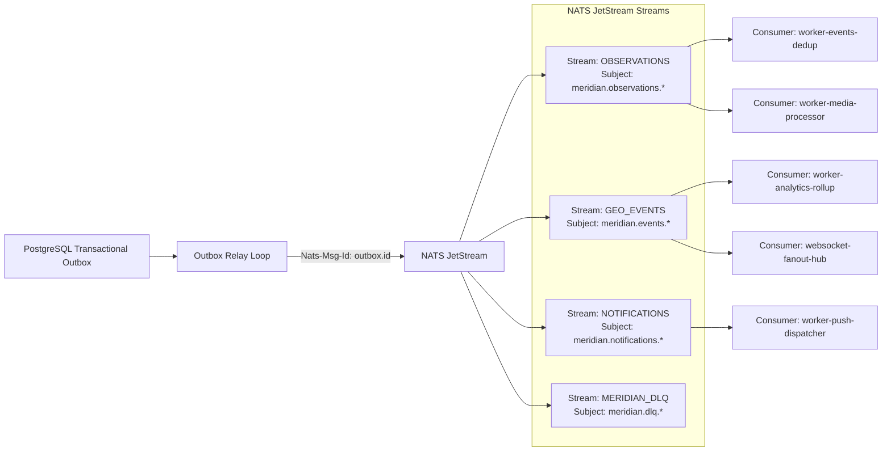

# Meridian Event Catalog & Messaging Architecture

**Document Version:** 1.0.0  
**Status:** Approved  
**Date:** 2026-11-22  
**Platform Codename:** Meridian  

---

## 1. NATS JetStream Stream Topology

Meridian organizes its asynchronous event fabric into four core NATS JetStream streams:



### Stream Configurations:

| Stream Name | Storage | Subjects Bound | Retention | Max Age | Deduplication Window |
| :--- | :--- | :--- | :--- | :--- | :--- |
| **`OBSERVATIONS`** | File | `meridian.observations.*` | Limits | 7 days | 2 minutes (`Nats-Msg-Id`) |
| **`GEO_EVENTS`** | File | `meridian.events.*` | Limits | 30 days | 2 minutes (`Nats-Msg-Id`) |
| **`NOTIFICATIONS`** | File | `meridian.notifications.*` | Limits | 3 days | 2 minutes (`Nats-Msg-Id`) |
| **`MERIDIAN_DLQ`** | File | `meridian.dlq.*` | WorkQueue | 90 days | None |

---

## 2. Event Catalog & Subject Schemas

All message headers strictly include:
- `Nats-Msg-Id`: UUIDv7 matching the origin `outbox.id`.
- `traceparent`: OpenTelemetry W3C distributed trace context (e.g. `00-4bf92f3577b34da6a3ce929d0e0e4736-00f067aa0ba902b7-01`).
- `Content-Type`: `application/json`.

---

### 2.1. Subject: `meridian.observations.created`
- **Stream:** `OBSERVATIONS`
- **Emitted When:** A raw citizen report is committed to PostgreSQL in `cmd/api`.
- **Payload Schema:**
  ```json
  {
    "event_id": "0193567a-bc12-7000-8000-000000000101",
    "observation_id": "0193567a-bc12-7000-8000-000000000101",
    "user_id": "0193567a-bc12-7000-8000-000000000001",
    "event_type": "pothole",
    "coordinates": [73.1812, 22.3072],
    "h3_r9": "8928308280fffff",
    "h3_r5_parent": "85283473fffffff",
    "severity": 3,
    "media_asset_id": "0193567a-bc12-7000-8000-000000000201",
    "created_at": "2026-11-22T14:30:00Z"
  }
  ```

---

### 2.2. Subject: `meridian.events.created` & `meridian.events.updated`
- **Stream:** `GEO_EVENTS`
- **Emitted When:** A canonical `geo_events` record is created, deduplicated, or changes status/state.
- **Payload Schema:**
  ```json
  {
    "event_id": "0193567a-bc12-7000-8000-000000000301",
    "geo_event_id": "0193567a-bc12-7000-8000-000000000301",
    "event_type": "pothole",
    "coordinates": [73.1812, 22.3072],
    "h3_r9": "8928308280fffff",
    "h3_r5_parent": "85283473fffffff",
    "status": "active",
    "verification_state": "community_confirmed",
    "severity": 4,
    "observation_count": 3,
    "last_observed_at": "2026-11-22T14:45:00Z",
    "expires_at": "2026-11-29T14:45:00Z",
    "updated_at": "2026-11-22T14:45:10Z"
  }
  ```

---

### 2.3. Subject: `meridian.events.h3.<h3_r5_hex>` (Realtime Viewport Fanout)
- **Stream:** Ephemeral Core NATS Subjects (In-Memory Pub/Sub)
- **Emitted When:** A geo-event is created or updated. Published directly to the Resolution 5 cell topic (e.g. `meridian.events.h3.85283473fffffff`).
- **Consumer:** `internal/realtime` WebSocket hub matches subscribed client sockets.

---

### 2.4. Subject: `meridian.dlq.failed`
- **Stream:** `MERIDIAN_DLQ`
- **Emitted When:** Any message exceeds `MaxDeliver` attempts on a consumer.
- **Payload Schema:**
  ```json
  {
    "original_subject": "meridian.observations.created",
    "original_msg_id": "0193567a-bc12-7000-8000-000000000101",
    "failed_consumer": "worker-events-dedup",
    "attempts": 5,
    "last_error": "pgx: connection refused",
    "failed_at": "2026-11-22T14:32:45Z",
    "original_payload": { ... }
  }
  ```

---

## 3. Consumer Specifications & Policies

| Consumer Name | Stream Bound | Filter Subject | Ack Policy | MaxDeliver | Backoff Schedule | Ack Wait |
| :--- | :--- | :--- | :--- | :--- | :--- | :--- |
| **`worker-events-dedup`** | `OBSERVATIONS` | `meridian.observations.created` | Explicit | 5 | 1s, 5s, 15s, 30s, 60s | 30s |
| **`worker-media-processor`**| `OBSERVATIONS` | `meridian.observations.created` | Explicit | 5 | 2s, 10s, 30s, 60s, 120s | 60s |
| **`worker-analytics-rollup`**| `GEO_EVENTS` | `meridian.events.*` | Explicit | 5 | 1s, 5s, 15s, 30s, 60s | 30s |
| **`websocket-fanout-hub`** | Core NATS | `meridian.events.h3.*` | None (Direct) | 1 | None | N/A |

---

## 4. Dead-Letter Queue (DLQ) & Administrative Requeue Procedure

1. **Automatic Routing:** When a consumer rejects a message 5 times, a NATS consumer interceptor packages the failure context and publishes it to `meridian.dlq.failed`.
2. **Inspection:** Administrators inspect failed items via CLI or `GET /v1/admin/dlq`.
3. **Requeue Execution:**
   - The admin API `POST /v1/admin/dlq/requeue` accepts a list of DLQ IDs.
   - The message is republished to its `original_subject` with an incremented requeue header: `X-Requeued-By: admin` and a new `Nats-Msg-Id`.
   - The DLQ record is acknowledged and removed from `MERIDIAN_DLQ`.

---

## 5. System Failure-Mode & Resilience Matrix

The platform is designed to maintain continuous observation ingestion even during complete external subsystem outages:

| Component Outage | Impact on Report Ingestion (`POST /v1/reports`) | Impact on Live Map & Routing | Operational Behavior & Recovery |
| :--- | :--- | :--- | :--- |
| **NATS Down** | **ZERO IMPACT (Succeeds)** | Real-time WebSocket updates paused; map shows latest database state. | Observation and outbox records commit to PostgreSQL. Outbox relay polls and pauses; resumes publishing once NATS reconnects. **Zero data loss.** |
| **Inference Service Down** | **ZERO IMPACT (Succeeds)** | Verification state remains `unverified`; no AI signal generated. | Report accepted immediately (`202 Accepted`). `worker-events` records AI signal as `unavailable`. Event relies on community/moderator signals. |
| **PostgreSQL Down** | **CRITICAL: Ingestion Fails** (Returns 503 Problem JSON). | Read queries fail. | Reverse proxy / health probes report `503 Service Unavailable`. Restored via PostgreSQL container restart. |
| **Object Storage Down** | **Presigned URL generation fails** (Returns 503 Problem JSON). | Media thumbnails fail to load. | Mobile client prompts user to retry submission. Cached map layers remain fully functional. |
| **Valhalla Down** | **ZERO IMPACT on Ingestion.** | Route calculation fails with 503; map displays warning. | Citizen reports are unaffected. Mobile navigation alerts driver: *"Routing temporarily unavailable"*. |
| **Nominatim Down** | **ZERO IMPACT on Ingestion.** | Address search fails; map search falls back to coordinates / Photon. | Coordinate-based hazard submissions succeed unimpeded. |
