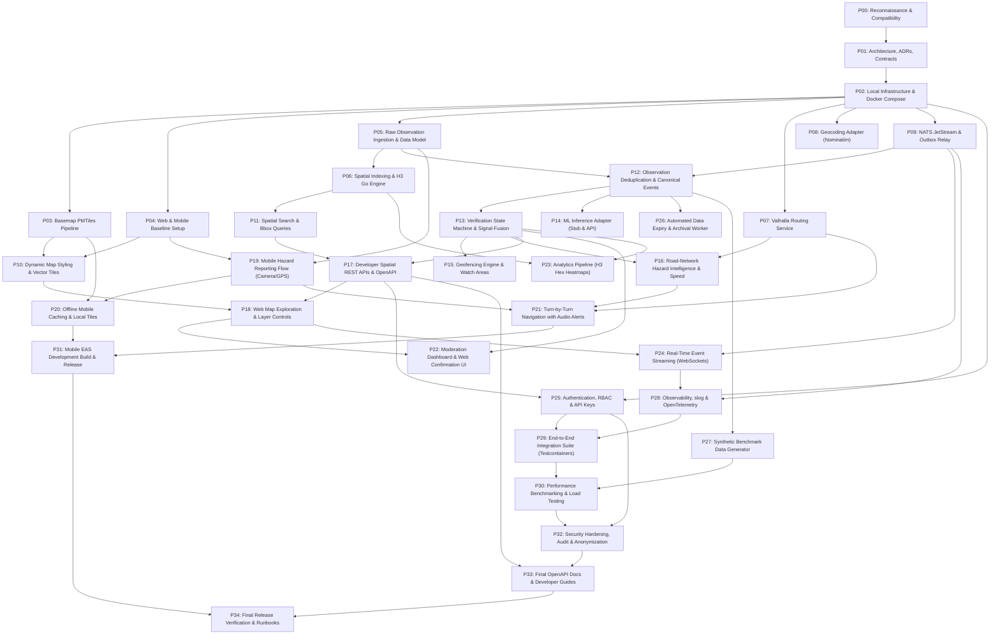

# Meridian Prompt Dependency Graph & Artifact Flow

**Document Version:** 1.0.0  
**Status:** Approved  
**Date:** 2026-11-22  
**Platform Codename:** Meridian  

---

## 1. Visual Dependency Graph (Mermaid)

The following directed acyclic graph (DAG) illustrates the strict prerequisite ordering across all 35 prompts (Prompt 00 through Prompt 34):

---

## 2. Prompt Input & Output Artifact Dependency Matrix

| Prompt | Title | Immediate Predecessors | Artifacts Consumed as Input | Artifacts Produced as Output |
| :---: | :--- | :--- | :--- | :--- |
| **00** | Workspace Reconnaissance | None (First prompt) | Developer machine, git status, primary registries | `docs/recon/*`, `PROGRESS.md`, `P00-report.md` |
| **01** | Architecture, ADRs, Contracts | Prompt 00 | `docs/recon/*` | `docs/architecture/*`, ADRs 0001–0025, `P01-report.md` |
| **02** | Local Infrastructure & Compose | Prompt 01 | `docs/recon/environment.md`, ADR-0001, ADR-0025 | `infra/compose/*`, `docker-compose.yml`, health checks |
| **03** | Basemap Generation (Planetiler) | Prompt 02 | Target region PBF extract, Java JDK 25 | `planetiler.pmtiles`, `infra/compose/pmtiles.yml` |
| **04** | Web & Mobile Baseline Setup | Prompt 02 | ADR-0002, ADR-0021, `workspace-inventory.md` | `apps/web/*`, `apps/mobile/*`, `packages/*` baseline |
| **05** | Raw Observation Ingestion | Prompt 02 | `docs/architecture/domain-model.md`, ADR-0006 | SQL migrations (`observations`), Go ingestion handlers |
| **06** | Spatial Indexing & H3 Go Engine | Prompt 05 | ADR-0003, ADR-0004, ADR-0005 | `internal/spatial/h3.go`, GiST indexes, H3 benchmarks |
| **07** | Valhalla Routing Service | Prompt 02 | Region PBF, ADR-0017 | Valhalla Docker container, routing tile build scripts |
| **08** | Geocoding Adapter (Nominatim) | Prompt 02 | ADR-0016, Port 8083 resolution | `internal/search/geocoder.go`, Nominatim compose |
| **09** | NATS JetStream & Outbox Relay | Prompt 02 | ADR-0012, `docs/architecture/event-catalog.md` | `outbox` table, relay daemon, NATS JetStream streams |
| **10** | Dynamic Map Styling & Vectors | Prompt 03, 04 | ADR-0015, `packages/design-tokens` | MapLibre style JSON, glyph/sprite configs |
| **11** | Spatial Search & Bbox Queries | Prompt 06 | `docs/architecture/api-conventions.md` | `internal/search`, `/v1/events?bbox=...` endpoint |
| **12** | Observation Deduplication | Prompt 05, 09 | `docs/architecture/domain-model.md` Section 3 | `cmd/worker-events`, clustering radius $R$ & window $T$ |
| **13** | Verification State Machine | Prompt 12 | `docs/architecture/signals-and-verification-policy.md` | Policy engine v1.0.0, signal fusion handlers |
| **14** | ML Inference Adapter | Prompt 12 | ADR-0013, `docs/recon/licences.md` | `internal/inference`, stub adapter, external client |
| **15** | Geofencing Engine | Prompt 13 | `docs/architecture/domain-model.md` | `internal/geofence`, polygon intersection triggers |
| **16** | Road-Network Hazard Intelligence| Prompt 07, 13 | ADR-0017, Valhalla edge IDs | `internal/routing/corridor.go`, hazard annotations |
| **17** | Developer Spatial REST APIs | Prompt 11, 13 | `docs/architecture/api-conventions.md`, ADR-0007 | `api/openapi/openapi.yaml`, `oapi-codegen` routes |
| **18** | Web Map Exploration UI | Prompt 10, 17 | `apps/web`, `packages/ui` | Next.js MapLibre interactive canvas, layer drawers |
| **19** | Mobile Hazard Reporting Flow | Prompt 04, 05 | `apps/mobile`, `src/hooks/use-current-location.ts` | Mobile camera capture, EXIF submission, upload flow |
| **20** | Offline Mobile Caching | Prompt 03, 19 | ADR-0021, `apps/mobile` | Mobile SQLite tile caching, offline observation queue |
| **21** | Mobile Turn-by-Turn Navigation | Prompt 07, 16, 19 | ADR-0017, `apps/mobile` | Active navigation screen, maneuver cards, audio chimes |
| **22** | Moderation Dashboard | Prompt 13, 18 | `docs/architecture/domain-model.md` Section 2.6 | Web moderation table, signal inspection, audit actions |
| **23** | Analytics Pipeline (Hex Heatmaps)| Prompt 06, 13 | ADR-0004, `h3_cell_stats` | `cmd/worker-analytics`, heatmap overlay layer |
| **24** | Real-Time Event Streaming (WS) | Prompt 09, 18 | ADR-0011, `docs/architecture/event-catalog.md` | `internal/realtime`, WebSocket hub, H3 cell fanout |
| **25** | Authentication, RBAC & API Keys | Prompt 02, 17 | ADR-0010, `docs/architecture/domain-model.md` | `internal/auth`, Argon2id, JWT middleware, API keys |
| **26** | Data Expiry & Archival Worker | Prompt 12 | `docs/architecture/domain-model.md` | `cmd/worker-cleanup`, TTL expiry sweep daemon |
| **27** | Synthetic Benchmark Data Seed | Prompt 12 | ADR-0023 | `scripts/benchmark/seed.go`, isolated schema seed |
| **28** | Observability & OpenTelemetry | Prompt 09, 24 | ADR-0020 | Structured slog middleware, OTel traces and metrics |
| **29** | End-to-End Integration Suite | Prompt 25, 28 | ADR-0022 | Testcontainers-Go suite covering Postgres & NATS |
| **30** | Performance & Load Testing | Prompt 27, 29 | `docs/architecture/performance-budgets.md` | `k6` benchmark suite, empirical budget validation |
| **31** | Mobile Build & EAS Profile | Prompt 20, 21 | ADR-0021, `app.json` | EAS cloud build profile, Android APK release build |
| **32** | Security Hardening & Audit | Prompt 25, 30 | `docs/architecture/threat-model.md` | `govulncheck`, audit gates, anonymization verify |
| **33** | Documentation & OpenAPI Specs | Prompt 17, 32 | Entire platform codebase | Published API documentation, developer runbooks |
| **34** | Final Release Verification | Prompt 31, 33 | All preceding prompts | Complete release verification report, packaged artifact |
