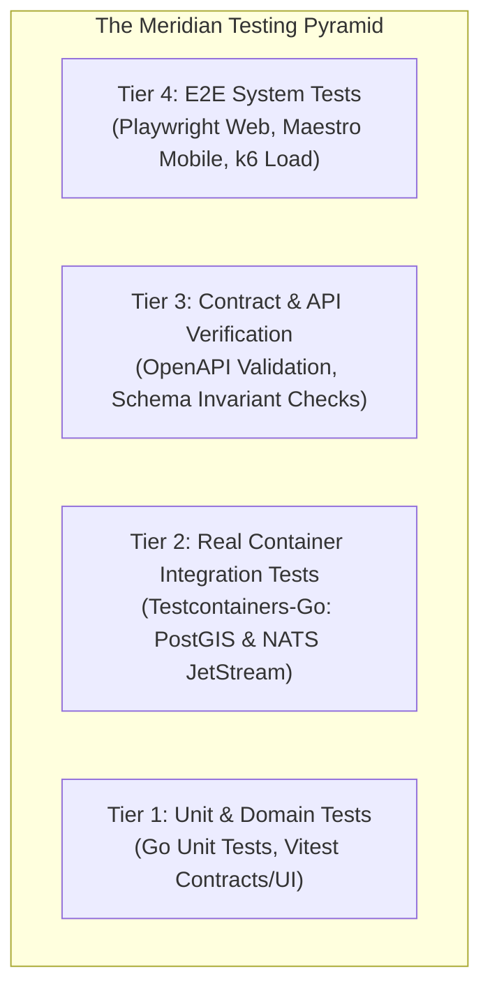
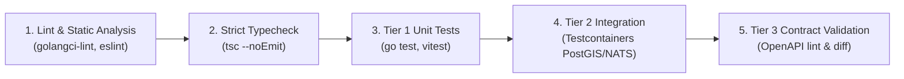

# Meridian Quality Engineering & Testing Strategy

**Document Version:** 1.0.0  
**Status:** Approved  
**Date:** 2026-11-22  
**Platform Codename:** Meridian  

---

## 1. Testing Pyramid & Quality Philosophy

Meridian adopts a multi-layered quality engineering strategy ensuring spatial correctness, distributed event reliability, and client rendering stability without over-relying on slow, fragile end-to-end tests:

---

## 2. Test Layer Specifications & Tooling

### 2.1. Tier 1: Unit & Domain Logic Tests
- **Backend (Go):** Standard library `testing` package with table-driven tests.
  - **Coverage Scope:** Uber H3 index conversions, verification policy state machine evaluations, coordinate validation math, cursor serialization/deserialization.
  - **Performance Requirement:** Entire Go unit suite must execute in $< 5\text{ seconds}$ with zero network or disk dependencies.
- **Frontend / Monorepo Packages (TypeScript):** **Vitest** (v5.1.1).
  - **Coverage Scope:** `packages/contracts`, `packages/api-client`, `packages/design-tokens`, UI component unit rendering.

---

### 2.2. Tier 2: Real Database & Message Broker Integration Tests
- **Framework:** **Testcontainers-Go** (v0.45.0, Apache-2.0).
- **Execution Model:**
  - Automated spin-up of real, ephemeral Docker containers for each test package:
    - `postgis/postgis:17-3.7-alpine`
    - `nats:2.15.3-alpine`
  - Automated execution of database migrations via `goose`.
- **Absolute Prohibition on In-Memory Database Mocks:**
  - Spatial queries (`ST_DWithin`, `ST_MakeEnvelope`, `ST_AsMVT`) and concurrency primitives (`FOR UPDATE SKIP LOCKED`) **must never be mocked with SQLite or in-memory stubs**. Real PostGIS is mandatory.
- **Coverage Scope:**
  - Transactional outbox commits and deduplication relay.
  - Spatial radius and bounding box queries against real GiST indexes.
  - Idempotent JetStream consumer acknowledgment and DLQ routing.

---

### 2.3. Tier 3: Contract & OpenAPI Compliance Tests
- **Tools:** `spectral`, `oapi-codegen/v2`, `openapi-typescript`.
- **Coverage Scope:**
  - Validating `api/openapi/openapi.yaml` against OpenAPI 3.0.3 standards.
  - Verifying that all generated TypeScript interfaces in `packages/contracts` match server-generated Go structs with zero field drift.
  - Testing RFC 9457 Problem Details schema compliance across all error conditions.

---

### 2.4. Tier 4: End-to-End Client & Load Tests
- **Web Application E2E (Playwright v1.65.1):**
  - Headless Chromium automated tests covering:
    - Interactive vector map rendering (MapLibre GL JS).
    - Citizen report submission flow.
    - Moderator event confirmation and rejection flows.
- **Mobile Application Flows (Maestro v2.1.1):**
  - Declarative UI test flows running against the Android Development Build:
    - Launching camera capture, attaching mock coordinates, verifying submission receipt.
    - Offline vector tile caching and reconnection sync.
- **Performance & Load Testing (k6):**
  - High-concurrency spatial query benchmarks ($10^4$ events) verifying performance budgets defined in `docs/architecture/performance-budgets.md`.

---

## 3. Continuous Integration (CI) Gates & Policies

Every code contribution and phase prompt must pass automated CI verification prior to completion:

### The Strict Non-Regression Rule:
- **No phase may merge or declare completion with failing, skipped, or weakened tests.**
- Commenting out tests, adding `@ts-ignore` to paper over contract mismatches, or disabling linters is strictly classified as a build failure.
- If an environmental prerequisite (e.g. Docker Engine) is unavailable, the engineer must document the block in `docs/recon/risks.md` rather than bypassing the test suite.
