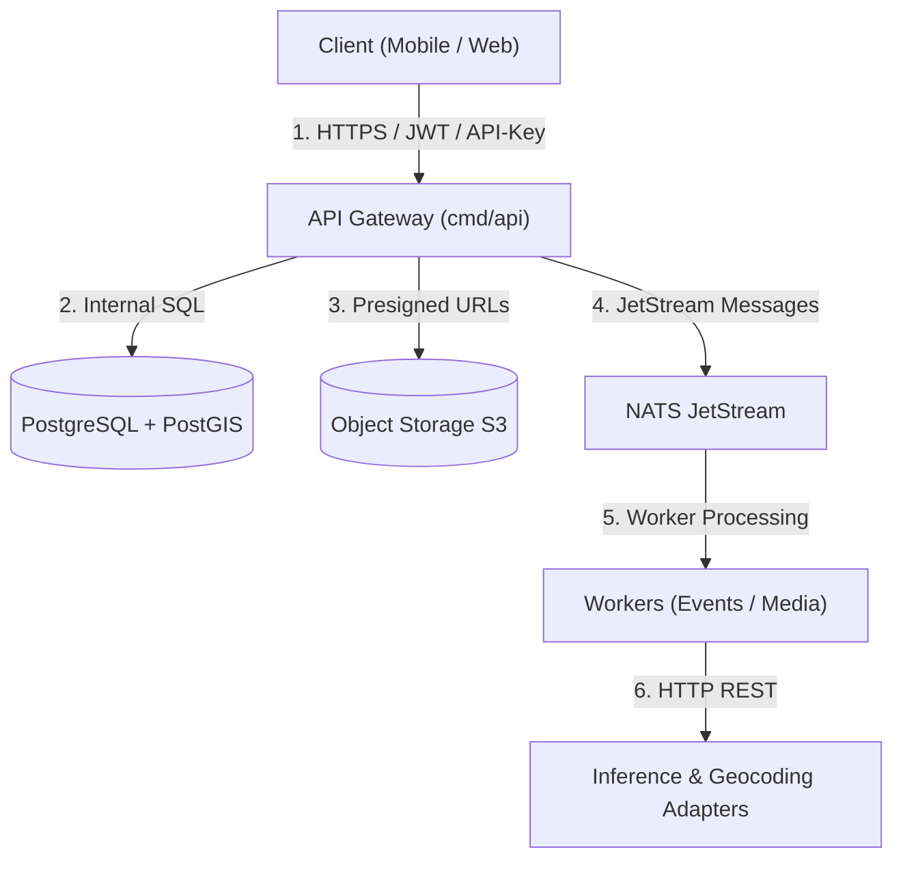

# Meridian Threat Model & Security Architecture

**Document Version:** 1.0.0  
**Status:** Approved  
**Date:** 2026-11-22  
**Platform Codename:** Meridian  

---

## 1. Overview & STRIDE Component Analysis

This document evaluates Meridian's security posture using the **STRIDE** methodology across all core system components, supplemented by in-depth abuse case modeling.

| STRIDE Threat Category | Target Component | Threat Description | Architectural Mitigation | Owning Prompt | Verification Test |
| :--- | :--- | :--- | :--- | :---: | :--- |
| **Spoofing** | Client Ingress | Attacker impersonates a legitimate user or moderator. | Ed25519/HMAC JWT validation, Argon2id passwords, rotating refresh tokens with session family revocation. | Prompt 25 | `TestAuth_TokenTampering_Rejection` |
| **Tampering** | Database / Media | Attacker manipulates road hazard records or uploads forged images. | Immutable `observations` and `event_signals` tables, SHA-256 media hashing, ELA authenticity checks. | Prompt 05, 14 | `TestMedia_Authenticity_TamperingDetected` |
| **Repudiation** | Moderation Actions | Moderator rejects valid community reports without accountability. | Append-only `moderation_actions` audit log recording moderator ID, previous state, new state, and reason. | Prompt 22 | `TestModeration_AuditTrail_Immutable` |
| **Information Disclosure** | Media Serving | Sensitive EXIF data (GPS, timestamps, device IDs) leaked to the public. | Complete EXIF stripping during derivative generation; only sanitized WebP images served publicly. | Prompt 05, 14 | `TestMedia_EXIFStripping_NoMetadata` |
| **Denial of Service** | Spatial Search API | Attacker queries massive bounding box (e.g. whole hemisphere) to exhaust DB CPU. | Enforced `MaxBboxAreaKm2` (2500 km²) validation; in-process token-bucket rate limiting per IP. | Prompt 11 | `TestSpatial_BboxLimit_Rejection` |
| **Elevation of Privilege** | REST Endpoints | Citizen user accesses administrative moderation or DLQ requeue APIs. | RBAC middleware enforcing strict role claims (`user`, `moderator`, `admin`) on handler functions. | Prompt 25 | `TestRBAC_UserCannotAccessModeratorEndpoint` |

---

## 2. In-Depth Abuse Cases, Mitigations & Verification Gates

### ABUSE-01: Fake or Spammed Hazard Reports
- **Attack Vector:** Malicious actor writes an automated bot script submitting thousands of fake potholes across a city to cause panic or disrupt navigation.
- **Mitigation:**
  1. In-process IP and user rate limiting (max 10 submissions per minute).
  2. Submissions require a valid media asset presigned in the same session.
  3. All new reports enter `verification_state = 'unverified'` and are hidden from default public navigation routes until confirmed.
  4. Deduplication clustering prevents spatial spam from creating multiple events.
- **Owning Prompt:** Prompt 05 (Observation Ingestion) & Prompt 12 (Deduplication).
- **Proving Test:** `TestIngestion_RateLimitAndDeduplication_SpamDefense`.

---

### ABUSE-02: Location Spoofing
- **Attack Vector:** User uses a mock GPS location tool on Android to report a hazard in another neighborhood while sitting at home.
- **Mitigation:**
  1. The `geo_validation` worker extracts EXIF GPS metadata from the uploaded photo and compares it against client-reported GPS.
  2. If the spatial delta exceeds 500 meters, Rule `POL-03` immediately triggers `verification_state = 'rejected'`.
  3. Mobile app captures sensor telemetry (cellular network country/carrier, GPS accuracy radius) to corroborate positioning.
- **Owning Prompt:** Prompt 05 (Media ingestion) & Prompt 13 (Verification policy).
- **Proving Test:** `TestVerification_LocationSpoofing_Rejected`.

---

### ABUSE-03: Coordinated Confirmation Fraud (Sybil Attacks)
- **Attack Vector:** An attacker creates 10 dummy accounts to corroborate their own fake pothole report, attempting to force it into `community_confirmed`.
- **Mitigation:**
  1. The verification policy (`signals-and-verification-policy.md`) requires corroborations to originate from **independent device IDs and distinct IP subnets**.
  2. Each user possesses a dynamic `trust_score` based on account age and historical accuracy. Confirmations from accounts with zero reporting history carry reduced weight.
  3. Confirmations require the user's current GPS position to be physically located within radius $R$ of the hazard at the time of voting.
- **Owning Prompt:** Prompt 13 (Verification State Machine).
- **Proving Test:** `TestVerification_SybilAttack_ThresholdProtection`.

---

### ABUSE-04: Malicious Image Uploads (Decompression Bombs & Malware)
- **Attack Vector:** Attacker uploads a 100 GB pixel decompression bomb (e.g. 100,000 x 100,000 sparse image compressed to 500 KB) or an executable script masked as a JPEG.
- **Mitigation:**
  1. Presigned URLs enforce maximum file upload size: `file_size_bytes <= 10485760` (10 MB).
  2. The media processing worker inspects the magic bytes (MIME type verification) before decompression.
  3. Image decoders enforce hard memory bounds on decoded canvas dimensions ($1920\times 1080$ maximum). Decoders reject images exceeding 16 megapixels.
  4. Images are transcoded to WebP; original executables or embedded payloads are discarded.
- **Owning Prompt:** Prompt 05 (Media Worker) & Prompt 32 (Security Hardening).
- **Proving Test:** `TestMedia_DecompressionBomb_GracefullyRejected`.

---

### ABUSE-05: Server-Side Request Forgery (SSRF) via Adapters
- **Attack Vector:** Attacker crafts a malicious report directing the ML inference adapter or geocoder adapter to query cloud metadata services (`http://169.254.169.254`) or internal network services.
- **Mitigation:**
  1. All adapter URLs (`INFERENCE_SERVICE_URL`, `NOMINATIM_URL`, `VALHALLA_URL`) are configured strictly via trusted server-side environment variables.
  2. Handlers never accept arbitrary external URLs from client payloads.
  3. HTTP clients for adapters enforce timeouts (5000ms) and disable redirect following.
- **Owning Prompt:** Prompt 08 (Geocoding), Prompt 14 (ML Inference).
- **Proving Test:** `TestAdapter_SSRFProtection_StrictEnvURLsOnly`.

---

### ABUSE-06: Database Scraping & Bbox Denial-of-Service
- **Attack Vector:** Competitor or attacker scripts continuous viewport queries spanning huge bounding boxes to scrape the entire database or crash PostgreSQL.
- **Mitigation:**
  1. API gateway validates `bbox` area against `MaxBboxAreaKm2` (2500 km²). Queries exceeding this are rejected with `BBOX_TOO_LARGE`.
  2. Maximum query limit is capped at `limit = 100`.
  3. Rate limiting restricts anonymous bounding box queries to 30 requests per minute per IP.
  4. Fast spatial indexes (`GiST`) prevent table scans.
- **Owning Prompt:** Prompt 11 (Spatial Search).
- **Proving Test:** `TestSpatial_BboxDoS_EnforcedLimits`.

---

### ABUSE-07: API Key Leakage & Compromise
- **Attack Vector:** Developer accidentally commits their API key to a public GitHub repository.
- **Mitigation:**
  1. Meridian never stores plaintext API keys in the database; only the `SHA-256` hash is persisted.
  2. The web management dashboard allows immediate one-click key revocation.
  3. API keys support optional IP whitelisting and configurable per-key rate limits.
- **Owning Prompt:** Prompt 25 (Authentication & API Keys).
- **Proving Test:** `TestAPIKey_Revocation_InstantInvalidation`.

---

### ABUSE-08: Moderator Account Abuse
- **Attack Vector:** A rogue municipal employee or compromised moderator account maliciously deletes legitimate hazard reports across a city.
- **Mitigation:**
  1. Deletions are soft-state transitions (`status = 'rejected'`).
  2. Every moderation action records the moderator's user ID, timestamp, prior state, and mandatory textual justification in `moderation_actions`.
  3. Admins can audit and bulk-revert actions executed by a specific moderator ID.
- **Owning Prompt:** Prompt 22 (Moderation Dashboard).
- **Proving Test:** `TestModeration_AuditLog_Integrity`.

---

### ABUSE-09: Supply-Chain Dependency Risk
- **Attack Vector:** A compromised third-party npm or Go package introduces malicious code into the build.
- **Mitigation:**
  1. All dependencies pinned to exact versions in `docs/recon/compatibility-matrix.md`.
  2. Automated vulnerability scanning in CI using `govulncheck` for Go and `pnpm audit` / `npm audit` for frontend.
  3. Zero unverified packages allowed.
- **Owning Prompt:** Prompt 01 (Compatibility Matrix) & Prompt 32 (Hardening).
- **Proving Test:** `TestSecurity_Govulncheck_ZeroVulnerabilities`.
